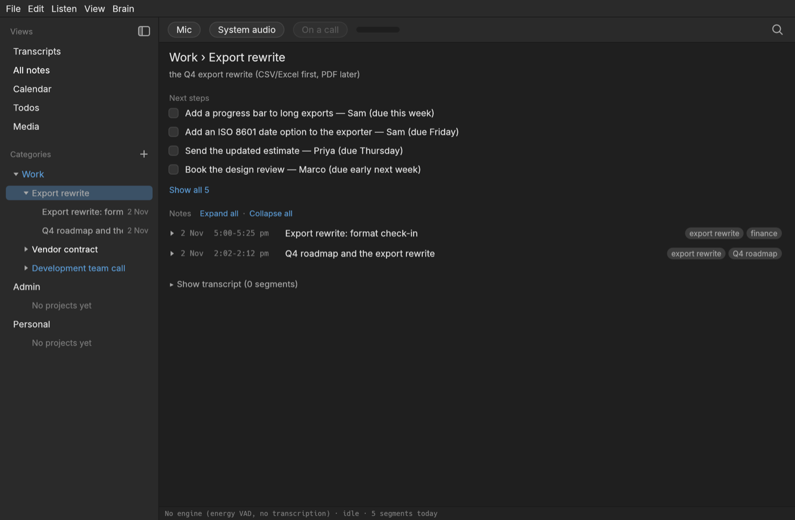

# OatsNotes

An always-on, on-device meeting and ambient transcription app for the Mac, with a "brain"
that turns what it hears into notes.

OatsNotes listens all day through the microphone and, optionally, the Mac's own audio (the
other side of a call, a video), transcribes on device with Parakeet, stores the transcript in a
local SQLite database, and lets a local `claude` CLI turn it into notes: a title, a summary,
decisions, action items and topics, filed into a tree of categories and auto-created projects.
It also keeps a calendar of significant dates, a todo list, a watch history of what played
on the Mac, and it answers spoken commands ("hey computer, remind me to …").

It is a personal project, built for one machine (an M2 MacBook Air) and run in the background
all day, so efficiency is a design goal: the app idles at about 0 % CPU and runs the speech
model only on closed speech segments.



## What it does

- **Transcripts**: everything heard, paged by day, with "me" and "them" lanes (microphone and
  system audio). Echoes of the Mac's own playback picked up by the microphone are detected
  and hidden.
- **Notes**: the brain cuts the transcript into episodes and writes a note for each, filed under
  a project. Project pages roll up next steps (action items with checkboxes), categories roll
  those up further. Notes can be edited, moved, merged, re-interpreted or deleted.
- **Calendar and todos**: dates mentioned in conversation become events; "hey computer" commands
  add todos, reminders, notes and projects. Reminders pop up in the window when due.
- **Media**: a YouTube video or a Spotify track playing in Firefox is recognised (from the
  browser's session store, no extension needed) and recorded as a play rather than mistaken
  for a conversation. Meeting apps and pages (Zoom, Teams, Meet, …) are always treated as
  calls.
- **Search** across notes, events, transcript lines, tags and media.
- **Undo** for quick edits, keyboard navigation in the sidebar, a status-bar item that keeps
  listening while the window is closed.

## Privacy

Everything stays on the machine. The database is owner-only on disk, in
`~/Library/Application Support/OatsNotes`. The app makes no network calls of its own except:

- the one-time speech model downloads (FluidAudio fetches Parakeet, Silero VAD and the two
  speaker-recognition models from Hugging Face on first run);
- the `claude` CLI, which sends transcript text to Anthropic under your own Claude login when
  the brain runs (turn it off with `OATS_BRAIN=off` and the app is a plain transcriber);
- YouTube thumbnails, only if you opt in under Preferences.

Speaker recognition (Preferences, on by default; `OATS_SPEAKERS=off`) keeps a voiceprint per
person heard — 256 numbers, in the local database only, never sent anywhere (the brain sees
names and labels like "them 2", never voiceprints). Preferences ▸ Speakers lists them, with
Forget.

The brain child process gets a minimal environment, no tools, no project settings and its own
empty working directory. `docs/security-review-2026-10-28.md` has the details.

## Requirements

- macOS 14.2 or later on Apple silicon (the system-audio capture uses Core Audio process taps).
- Xcode (the vendored FluidAudio bridge is a Swift package built by `cargo build`).
- Rust 1.95 or later.
- The `claude` CLI, logged in, for the brain. Without it the app still listens and transcribes.

## Build and run

```bash
cargo build --release -p oats-notes        # the first build compiles the Swift package (minutes)
./target/release/oats-notes --listen       # start listening as soon as the model is ready
```

The first run downloads the speech model (about 600 MB) into
`~/Library/Application Support/FluidAudio`. Run from a terminal, macOS asks that terminal for
microphone access; system audio needs "System Audio Recording Only" under System Settings →
Privacy & Security → Screen & System Audio Recording, granted to the app that launched the
terminal. Permission changes need that app restarted.

Useful switches:

```bash
OATS_ENGINE=null ./target/release/oats-notes     # no speech model: UI work, speech detected but not transcribed
OATS_BRAIN=off …                                  # never call claude
OATS_DATA_DIR=/path …                             # where the database lives
./target/release/oats-notes --listen --audio-file speech.wav   # a 16 kHz mono WAV instead of the microphone
./target/release/oats-notes --selftest out.png --project       # render a seeded window to a PNG, no display needed
```

`CLAUDE.md` is the full reference: every view, the brain's tiers and prompts, the database
schema, the audio lanes and the echo rules, and every environment knob.

## Development

```bash
./ci.sh     # fmt --check, clippy with warnings denied, the whole test suite
```

The UI is tested headless with `egui_kittest`; the brain's tests use a fake `claude` script
that answers by schema, so nothing in the suite calls the real CLI or needs a microphone.

Layout:

```
crates/oats-core               engine contract, segmenter, SQLite store, pipeline, echo rules
crates/oats-brain              claude CLI wrapper, episode cutting, prompts, hotword commands, scheduler
crates/oats-audio              microphone and system-audio capture (cpal), resampling, the chime
crates/oats-engine-fluidaudio  the macOS speech engine (Parakeet + Silero VAD on CoreML)
crates/oats-status*            the status-bar item contract and its macOS implementation
crates/oats-sources*           which apps are playing audio (Core Audio process list)
crates/oats-media              Firefox session-store reader, media / meeting classification
crates/oats-ui                 the egui shell: every view
apps/oats-notes                the binary
vendor/                        pinned, modified copies of fluidaudio-rs and cpal (see THIRD_PARTY.md)
```

Only two components are platform-specific, the speech engine and the status-bar item, each
behind a platform-neutral contract. A Linux port means one engine crate and one status crate.

## Third-party code

See `THIRD_PARTY.md` for the vendored crates and the fetched Swift package, and
`assets/ATTRIBUTION.md` for the bundled font.

## License

GPL-3.0-only, as declared in `Cargo.toml`. See `LICENSE`.
